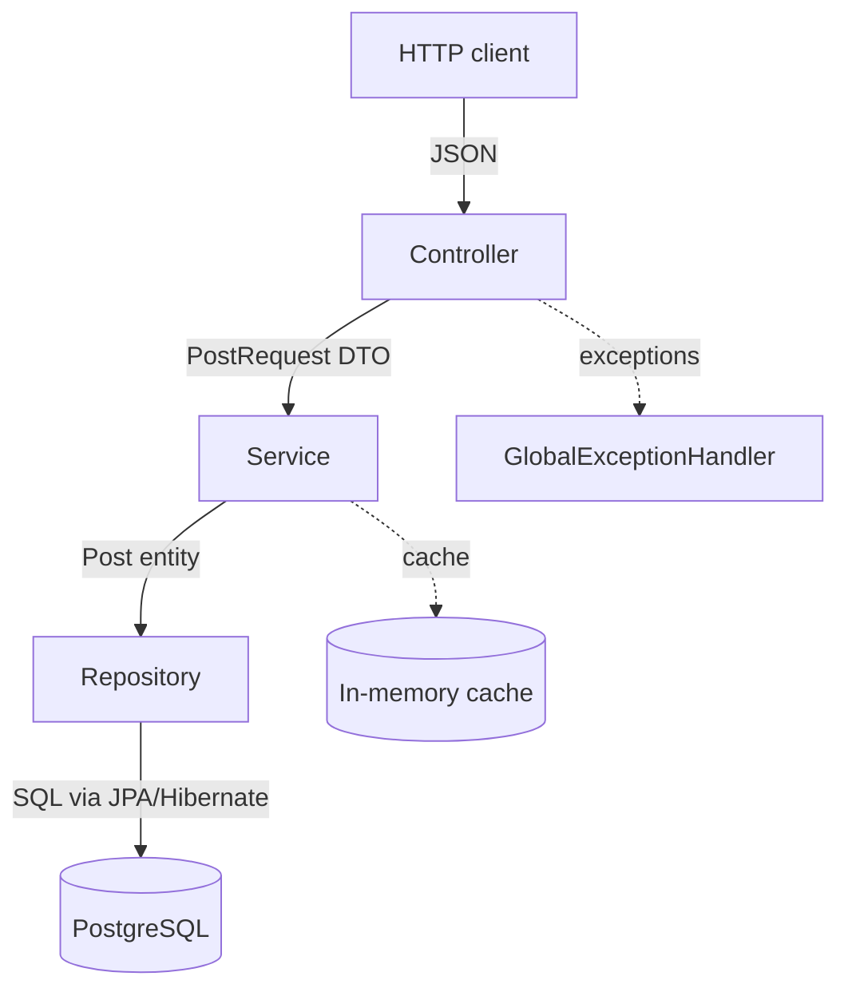

# Technical Documentation

This document explains how the Social Media Manager API works internally. The goal is that a developer can understand the code structure without reading every file.

For setup and usage instructions, see [README.md](README.md).

---

## Architecture

The application follows a **layered architecture**. Each layer has a single responsibility and only talks to the layer directly below it.



**Why this architecture:** the problem is small (three operations, one entity), so a layered design gives clear separation of concerns without the overhead of heavier patterns such as hexagonal architecture. Business rules live in the service layer, which keeps them independent from HTTP and the database and makes them easy to unit test.

### Package structure

```
dev.leo.social_media_manager
├── controller/   PostController          REST endpoints
├── service/      PostService             Business rules and caching
├── repository/   PostRepository          Database access (Spring Data JPA)
├── model/        Post                    JPA entity (database table)
├── dto/          PostRequest             Input payload
│                 PostResponse            Output payload
├── mapper/       PostMapper              DTO <-> entity conversion
├── exception/    FutureDateException     Business rule violation
│                 GlobalExceptionHandler  Maps exceptions to HTTP responses
└── config/       CacheConfig             Enables Spring Cache
                  OpenApiConfig           Swagger / OpenAPI metadata
```

### Key classes

| Class | Responsibility |
|---|---|
| `PostController` | Receives HTTP requests, validates the payload format (`@Valid`), delegates to the service and returns the HTTP status. Contains no business logic. |
| `PostService` | Applies the business rule (no future dates), chooses between listing all posts or filtering, and manages the cache. |
| `PostRepository` | Interface extending `JpaRepository`. Spring Data generates the implementation, including the derived query `findByPublished`. |
| `Post` | JPA entity mapped to the `posts` table. |
| `PostRequest` / `PostResponse` | Java records defining the JSON contract of the API, separate from the database model. |
| `PostMapper` | Converts between DTOs and the entity in a single place. |
| `GlobalExceptionHandler` | Turns exceptions into consistent `400 Bad Request` responses using the `ProblemDetail` standard. |

---

## Data model

### Table `posts`

| Column | Type | Constraints | Java field |
|---|---|---|---|
| `id` | `bigint` | Primary key, generated by the database (identity) | `Long id` |
| `title` | `varchar(255)` | Not null | `String title` |
| `caption` | `text` | Not null | `String caption` |
| `post_date` | `date` | Not null | `LocalDate date` |
| `published` | `boolean` | Not null | `boolean published` |

Notes:

- `caption` uses `TEXT` because social media captions can be longer than 255 characters.
- The date column is named `post_date` because `date` is an SQL keyword. In Java the field is still called `date`.
- The schema is created automatically by Hibernate (`spring.jpa.hibernate.ddl-auto=update`). For a production system, versioned migrations (Flyway or Liquibase) would be the recommended next step.

### Entity vs DTOs

The entity and the API payloads are intentionally separate:

| Aspect | Entity (`Post`) | API (`PostRequest` / `PostResponse`) |
|---|---|---|
| Published flag | `published` (Java convention for booleans) | `isPublished` (required JSON name, via `@JsonProperty`) |
| Date | `LocalDate` | String in `dd/MM/yyyy` (via `@JsonFormat`) |
| Id | Generated by the database | Not accepted on input, returned on output |

This allows the database and the API contract to evolve independently and prevents internal fields from being exposed by accident.

---

## API contract

Base URL: `http://localhost:8081`

Interactive documentation: `http://localhost:8081/swagger-ui.html`

### `POST /post`: create a post

**Request body**

```json
{
  "title": "Title 1",
  "caption": "Caption 1",
  "date": "21/12/2023",
  "isPublished": false
}
```

| Field | Type | Rules |
|---|---|---|
| `title` | string | Required, not blank |
| `caption` | string | Required, not blank |
| `date` | string `dd/MM/yyyy` | Required, cannot be in the future (today is accepted) |
| `isPublished` | boolean | Required |

**Response `201 Created`**

```json
{
  "id": 1,
  "title": "Title 1",
  "caption": "Caption 1",
  "date": "21/12/2023",
  "isPublished": false
}
```

### `GET /post`: list posts

| Query parameter | Type | Required | Description |
|---|---|---|---|
| `isPublished` | boolean | No | If present, returns only posts with that status. If absent, returns all posts. |

Results are always ordered by `id` (ascending).

**Response `200 OK`**

```json
[
  {
    "id": 1,
    "title": "Title 1",
    "caption": "Caption 1",
    "date": "20/12/2023",
    "isPublished": true
  },
  {
    "id": 3,
    "title": "Title 3",
    "caption": "Caption 3",
    "date": "22/12/2023",
    "isPublished": true
  }
]
```

When no posts match, the response is an empty array `[]`.

---

## Business logic

### Future date validation

The rule "a post cannot have a future date" lives in `PostService.validateDateIsNotInFuture`, which runs before anything is saved. If the date is after today, a `FutureDateException` is thrown and the repository is never called.

The rule is kept only in the service layer (and not as a `@PastOrPresent` annotation on the DTO) so that it exists in exactly one place, returns one consistent message and is covered by the unit tests.

### Listing

A single service method, `getPosts(Boolean isPublished)`, serves both read operations:

- `isPublished == null` → `findAll(Sort.by("id"))`
- otherwise → `findByPublished(isPublished, Sort.by("id"))`

---

## Error handling

All errors are handled centrally by `GlobalExceptionHandler` (`@RestControllerAdvice`) and returned in the **Problem Details** format ([RFC 9457](https://www.rfc-editor.org/rfc/rfc9457)), which Spring supports natively through `ProblemDetail`. Every error therefore has the same structure.

| Situation | Exception | Status |
|---|---|---|
| Date in the future | `FutureDateException` | 400 |
| Missing or blank field | `MethodArgumentNotValidException` | 400 |
| Malformed JSON or invalid date format | `HttpMessageNotReadableException` | 400 |

### Future date

```json
{
  "type": "about:blank",
  "title": "Bad Request",
  "status": 400,
  "detail": "Post date cannot be in the future: 01/01/2099",
  "instance": "/post"
}
```

### Validation errors

Field errors are listed in an extra `errors` property:

```json
{
  "type": "about:blank",
  "title": "Bad Request",
  "status": 400,
  "detail": "Invalid request fields",
  "instance": "/post",
  "errors": {
    "title": "must not be blank",
    "isPublished": "must not be null"
  }
}
```

### Malformed body or wrong date format

```json
{
  "type": "about:blank",
  "title": "Bad Request",
  "status": 400,
  "detail": "Malformed JSON or invalid date format (expected dd/MM/yyyy)",
  "instance": "/post"
}
```

---

## Caching

Read operations are cached with Spring Cache, enabled in `CacheConfig` (`@EnableCaching`).

| Method | Annotation | Effect |
|---|---|---|
| `getPosts` | `@Cacheable("posts")` | The result is stored using the `isPublished` value as key (`null`, `true` or `false`). Repeated calls with the same key do not hit the database. |
| `createPost` | `@CacheEvict(value = "posts", allEntries = true)` | Clears the whole cache when a post is created, so the next read returns up-to-date data. |

The whole cache is cleared on creation because a new post affects both the "all posts" list and one of the filtered lists.

The cache provider is Spring's default in-memory implementation (`ConcurrentMapCacheManager`). It is enough for a single instance. If the API were scaled to multiple instances, a distributed cache such as Redis could be plugged in through configuration only, with no changes to the service code.

---

## Testing

- **Unit tests** for `PostService` (`PostServiceTest`) use JUnit 5 and Mockito. The repository and mapper are mocked, so the tests run without a database or Spring context.
- Scenarios covered: past date, today's date (boundary), future date (exception and no save), list all, list filtered and empty list.
- **JaCoCo** measures coverage. The `check` goal is bound to `mvnw verify` and **fails the build if the service layer is below 100% line coverage**.

Report: `target/site/jacoco/index.html`

---

## Containerization

### Dockerfile

- **Multi-stage build:** the first stage compiles with the full JDK, the second runs the JAR on a JRE-only image, which makes the final image smaller.
- **Dependency layer caching:** `pom.xml` is copied and dependencies are downloaded before the source code, so rebuilds after code-only changes are fast.
- **Non-root user:** the application runs as the `spring` user instead of root.

### docker-compose.yml

- **`postgres`** service with a health check (`pg_isready`) and a named volume (`postgres-data`) so data survives restarts.
- **`app`** service that only starts when the database is healthy (`depends_on: condition: service_healthy`).
- The database connection is overridden through environment variables (`SPRING_DATASOURCE_URL`, etc.), using the service name `postgres` as host. No code or property file changes are needed between local and container execution.

---

## Configuration

Main properties in `src/main/resources/application.properties`:

| Property | Value | Purpose |
|---|---|---|
| `server.port` | `8081` | API port |
| `spring.datasource.url` | `jdbc:postgresql://localhost:5432/social-media-manager` | Database connection (overridden in Docker) |
| `spring.jpa.hibernate.ddl-auto` | `update` | Creates or updates the schema on startup |
| `spring.jpa.show-sql` | `true` | Logs SQL statements, useful to observe the cache |
| `spring.jpa.open-in-view` | `false` | Database connections are not held open during the whole HTTP request |